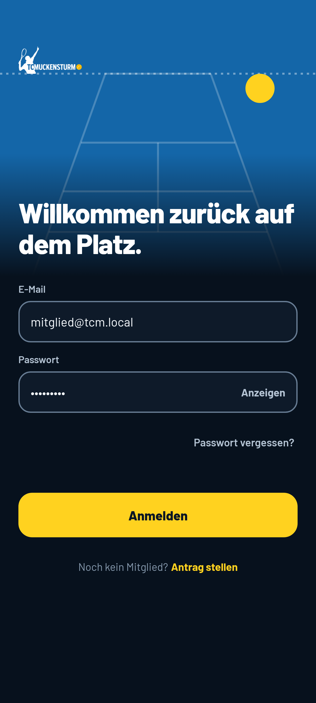
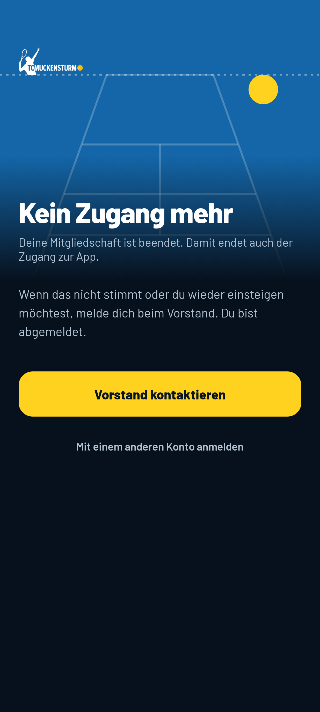
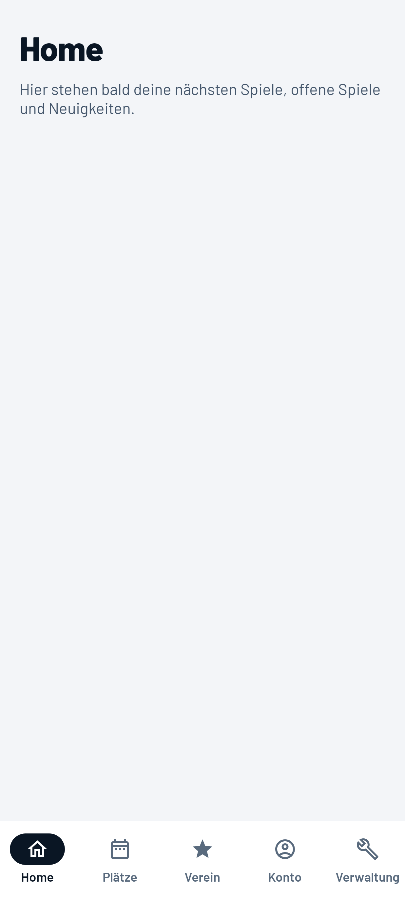
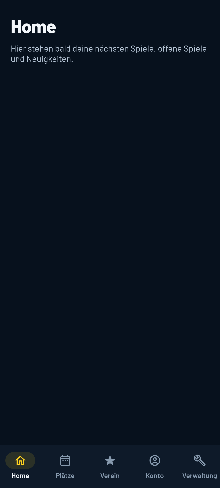
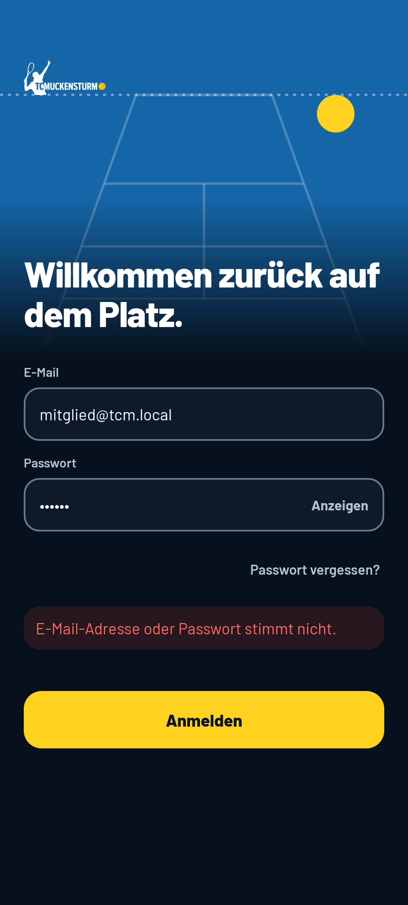
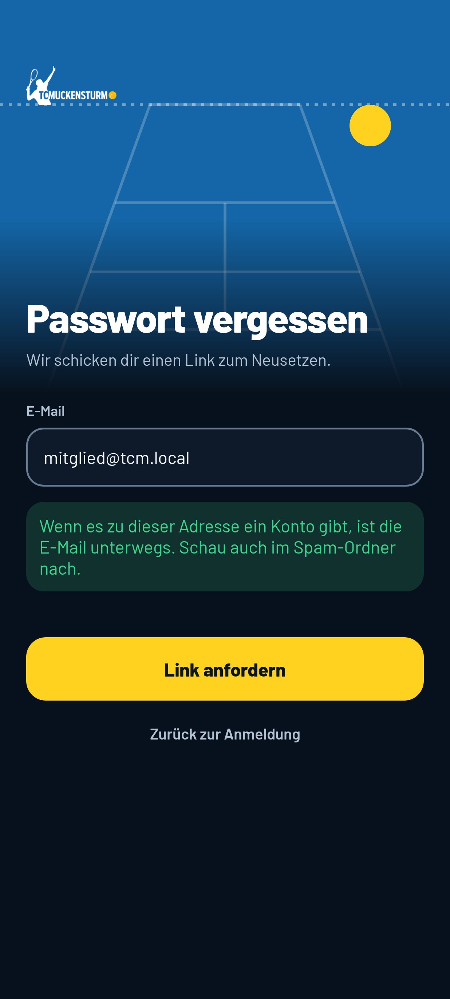
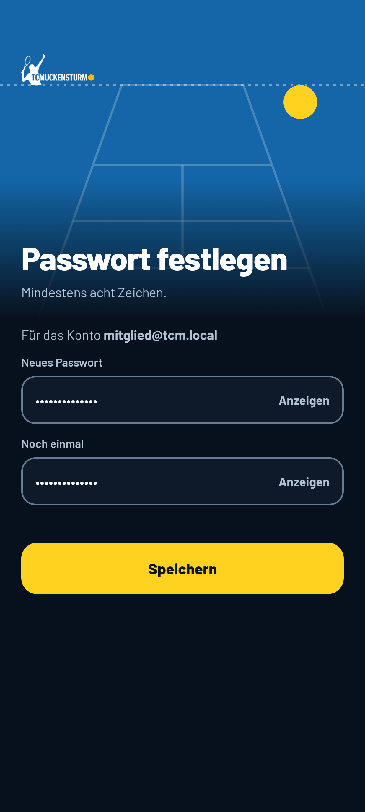
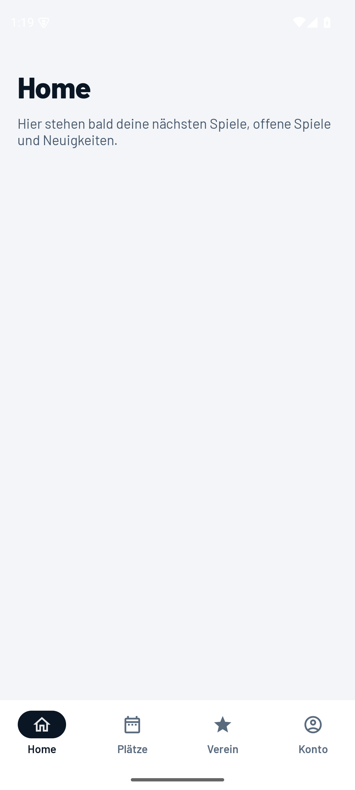

# TC Muckensturm – native Android-App

Grundgerüst der nativen App (Kotlin, Jetpack Compose, Android 8.0+ / API 26, nur Telefon,
Hochformat, Deutsch). Gegenstück zu `apps/ios` (Spur N2). Die Expo-App in `apps/mobile` bleibt
unverändert, bis diese App fertig ist. Web und Supabase bleiben.

| Anmelden (helles System) | Anmelden (dunkles System) | Kein Zugang | Tabs, hell | Tabs, dunkel |
|---|---|---|---|---|
|  |  |  |  |  |

| Anmeldefehler | Passwort vergessen | Passwort festlegen | Emulator, angemeldet |
|---|---|---|---|
|  |  |  |  |

Die Bilder bis auf das letzte entstehen ohne Gerät (Robolectric + Roborazzi, `BildschirmfotoTest`).
Die Anmeldeseiten sind wie in iOS und Expo immer dunkel; „hell“ zeigt, dass ein helles System daran
nichts ändert. Das letzte Bild ist der Rauchtest im Emulator: Variante `lokal`, angemeldet als
`mitglied@tcm.local` gegen den lokalen Stack (vorher: `docs/rauchtest-anmelden.png`). Die
hellen Symbole in dessen Statusleiste sind ein Fehler, der danach behoben wurde (`Systemleisten` in
`theme/Theme.kt`); das Bild ist noch nicht neu aufgenommen.

## Voraussetzungen

- **JDK 21** (z. B. `brew install openjdk@21`). Gradle lädt sich selbst über den Wrapper (9.5.1).
- **Android SDK** mit genau diesen Paketen (`sdkmanager`):
  `platform-tools`, `platforms;android-35`, `build-tools;35.0.0`, für den Emulator zusätzlich
  `emulator` und `system-images;android-35;google_apis;arm64-v8a` (AVD z. B. `tcm-pixel`).
  `gradle.properties` setzt `android.builder.sdkDownload=false`: Fehlt etwas, bricht der Build ab,
  statt still weitere Pakete zu laden.
- Für die Variante `lokal`: der lokale Supabase-Stack (`pnpm db:start` im Repo).

```bash
export JAVA_HOME=/opt/homebrew/opt/openjdk@21/libexec/openjdk.jdk/Contents/Home
export ANDROID_HOME=$HOME/Library/Android/sdk
```

## Bauen und testen

```bash
cd apps/android
cp lokal.properties.example lokal.properties   # einmalig, Key aus `supabase status` (Publishable)
./gradlew test lint                            # alle Tests und Lint
./gradlew :app:assembleLokalDebug              # APK für den Emulator
./gradlew :app:installLokalDebug               # auf ein laufendes Gerät/Emulator
./gradlew :app:recordRoborazziLokalDebug       # Bildschirmfotos nach docs/ neu schreiben
```

`pnpm verify` im Repo-Wurzelverzeichnis berührt `apps/android` nicht (kein Teil des
pnpm-Workspace). Eine CI für Android gibt es noch nicht.

### Rauchtest im Emulator

```bash
$ANDROID_HOME/emulator/emulator -avd tcm-pixel -no-window -no-audio -no-snapshot &
adb wait-for-device
./gradlew :app:installLokalDebug
adb shell am start -n de.tcmuckensturm.app.lokal/de.tcmuckensturm.app.HauptActivity
# E-Mail und Passwort per `adb shell input tap/text` eintragen (Seed: mitglied@tcm.local, Passwort aus supabase/seed.sql)
adb exec-out screencap -p > docs/rauchtest-angemeldet.png
adb emu kill
```

Der Emulator erreicht den lokalen Stack des Rechners unter `http://10.0.2.2:54321`. Klartext-HTTP
ist nur in der Variante `lokal` und nur für `10.0.2.2`, `127.0.0.1` und `localhost` erlaubt
(`src/lokal/res/xml/netzwerk.xml`).

## Varianten

| Variante | Supabase | Paket | Name | URL-Schema | SITE_URL |
|---|---|---|---|---|---|
| `lokal` (nur Debug) | lokaler Stack, Werte aus `lokal.properties` (gitignored, Vorlage `lokal.properties.example`) | `de.tcmuckensturm.app.lokal` | TCM Lokal | `tcmlokal` | – |
| `dev` | Dev-Projekt, Werte wie `apps/ios/Konfiguration/Dev.xcconfig` (öffentlicher Publishable Key) | `de.tcmuckensturm.app.dev` | TCM Dev | `tcmdev` | `https://dev.tennisclub-muckensturm.de` |
| `prod` | **TODO** – Werte fehlen noch, die App zeigt „Konfiguration fehlt“ | `de.tcmuckensturm.app` | TC Muckensturm | `tcm` | `https://app.tennisclub-muckensturm.de` |

- Die Werte kommen als `BuildConfig` (`SUPABASE_URL`, `SUPABASE_KEY`, `SITE_URL`, `URL_SCHEMA`) in
  `start/Umgebung.kt`. Fehlt etwas, zeigt die App den Hinweis statt abzustürzen.
- **Prod-Paket gegen das Dev-Backend** (wie `TestFlight.xcconfig` in iOS):
  `./gradlew :app:bundleProdRelease -Ptcm.prodBackend=dev`.
- **Versionsnummer:** `-Ptcm.versionCode=<n>` (Standard 1).
- **Signieren:** Debug mit dem Debug-Schlüssel von Android. Release nur, wenn ein Keystore angegeben
  ist, über Gradle-Properties oder Umgebung: `tcm.keystore`/`TCM_KEYSTORE`,
  `tcm.keystorePasswort`/`TCM_KEYSTORE_PASSWORT`, `tcm.keyAlias`/`TCM_KEY_ALIAS`,
  `tcm.keyPasswort`/`TCM_KEY_PASSWORT`. Keystores (`*.keystore`, `*.jks`) sind gitignored.
- **App Links:** `autoVerify` für `https://app.tennisclub-muckensturm.de/passwort-setzen` und
  `https://dev.tennisclub-muckensturm.de/passwort-setzen`. Die Prüfung gelingt erst, wenn das Web
  unter `/.well-known/assetlinks.json` die Fingerprints liefert (`ANDROID_APP_FINGERPRINTS`, Spur
  N3); bis dahin öffnet der Link das Web, und die App kommt über das eigene Schema an den Link.

## Aufbau

```
apps/android
├── kern/          reines Kotlin/JVM, ohne Android: portierte Logik aus @tcm/core
├── app/           die App (Compose)
│   └── src/main/kotlin/de/tcmuckensturm/app/
│       ├── start/        Umgebung, Sitzung (Weiche), StartLogik, Passwortlink, PasswortAblauf
│       ├── daten/        Supabase-Client, Sitzungsspeicher, Verschluesselung, Fehlerform, Zugangsdaten
│       ├── theme/        TcmTheme aus packages/ui/generated/Tokens.kt, Schriften, Erscheinungsbild
│       ├── navigation/   HauptTab (die Tabs), HauptTabs (ein NavHost)
│       └── bildschirme/  anmeldung, keinzugang, onboarding, home, plaetze, verein, konto, verwaltung
└── docs/          Bildschirmfotos
```

Für parallele Spuren gilt:

- **Je Tab ein Paket** unter `bildschirme/` mit einer Datei `<Tab>Graph.kt`: ein
  `@Serializable data object <Tab>Graph` (Ziel des Tabs), ein Startziel und
  `NavGraphBuilder.<tab>Graph(nav)`. Weitere Ziele eines Tabs kommen in dessen Paket und Graph.
  `navigation/HauptTabs.kt` bindet die Graphen ein und muss dafür nicht angefasst werden.
- **Datenzugriff je Bereich in einer eigenen Datei** unter `daten/` (wie `Zugangsdaten.kt`):
  `Platzdaten.kt`, `Startdaten.kt`, `Vereinsdaten.kt`, `Kontodaten.kt` … Nur RPCs aus
  `docs/native/app-api.md`, Fehlertexte über `translateDbError` bzw. `Meldung`.
- **Kernlogik** nach `kern/` (Paket `de.tcmuckensturm.kern`), je Thema eine Datei, geprüft gegen die
  Golden Files.
- Sprung in einen anderen Tab: `LocalZuTab.current(HauptTab.VEREIN)`. Sitzung und Client:
  `LocalSitzung.current`.
- Ein Modul `:widgets` (Glance) folgt in der Widget-Spur; es liest dieselbe Sitzung
  (`Sitzungsspeicher.fuer(context)`).

## Was schon da ist

- **Start-Logik** (`start/StartLogik.kt`, wie `StartLogik.swift`): ohne Sitzung „Anmelden“, sonst
  `mein_zugang`: kein Zugang (`zugangsGrund`) → „Kein Zugang“ (meldet ab), Onboarding offen →
  Platzhalter, sonst Tabs Home, Plätze, Verein, Konto und „Verwaltung“ bei Platzrechten
  (`ich().roles`). Die Weiche (`start/Sitzung.kt`) folgt `sessionStatus` von supabase-kt.
- **Sitzung** (`daten/Sitzungsspeicher.kt`): als JSON, AES-256-GCM-verschlüsselt mit einem Schlüssel
  im Android Keystore (Alias `tcm-sitzung`), abgelegt in einem DataStore. Kein
  `EncryptedSharedPreferences` (abgekündigt). Was nicht entschlüsselt werden kann (neuer Schlüssel
  nach Neuinstallation, Sicherung), gilt als abgemeldet und wird gelöscht. Keine Cloud-Sicherung
  (`allowBackup=false`).
- **Anmelden, Passwort vergessen, Passwort festlegen** wie in iOS, Texte wortgleich mit der
  Expo-App: Autofill über `ContentType` (Benutzername/E-Mail, Passwort, neues Passwort), Fehler über
  `kern/Anmeldefehler.kt`, Link-Auswertung `start/Passwortlink.kt` (`token_hash` + `type`,
  übergangsweise Sitzung im Fragment, Fehler im Link), Rückfrage, wenn schon ein anderes Konto
  angemeldet ist, 15 s Frist beim Einlösen. Der Client nutzt `FlowType.IMPLICIT` wie supabase-js.
- **Kein Zugang** wie iOS (`kern/Zugang.kt`).
- **Abmelden** zentral in `Sitzung.abmelden()` (global, ohne Netz nur lokal).
- **Theme:** Farben, Abstände, Radien und Schrift aus `packages/ui/generated/Tokens.kt` (als
  Quellverzeichnis eingebunden, nicht kopiert), Hell/Dunkel/System in einem DataStore
  (`erscheinungsbild`), Barlow und Barlow Semi Condensed unter `res/font` (Lizenz:
  `assets/lizenzen/OFL-Barlow.txt`).
- **Kern** (`kern/`): Zeit (`berlinTime`, `dayTag`, `minutesOf`, `timeToMinutes`, `minutesToTime`,
  `dayLabel` …), `translateDbError`, Anmeldefehler, `zugangsGrund`, `sichererWeiterPfad`.

## Tests

- `:kern` (JUnit 5): ein generischer Lader für `packages/core/golden/*.json` (als Testressource
  eingebunden) prüft jede Datei auf Lesbarkeit und jeden Fall der portierten Funktionen
  (`KernGoldenTest`), dazu `AnmeldefehlerTest` mit den Fällen aus `anmeldefehler.test.ts`.
- `:app` (JUnit 4, Robolectric, nur Variante `lokalDebug`): `StartLogikTest`, `PasswortlinkTest`
  (Fälle aus `apps/mobile/src/lib/passwortlink.test.ts`), `PasswortAblaufTest`, `UmgebungTest`,
  `SitzungsspeicherTest` (Verschlüsselung, Unlesbares, Löschen), `FehlerformTest`, `ThemeTest`
  (Schriften, Farbschema) und `BildschirmfotoTest`.
- Der Android Keystore fehlt in Robolectric. Die Tests des Sitzungsspeichers nehmen deshalb einen
  Software-Schlüssel; der echte Keystore läuft im Emulator-Rauchtest.

## Was fehlt

- Screens: Onboarding, Home, Plätze, Verein, Konto, Verwaltung (Platzhalter), Widget (`:widgets`).
- Push (FCM): Anmeldung des Tokens und Abmeldung beim Abmelden (`TODO` in `Sitzung.abmelden()`).
- Prod-Werte (Supabase-URL und -Key), Release-Keystore, Fingerprints in `assetlinks.json`.
- R8/Minify ist für Release noch aus (Regeln für supabase-kt/Ktor/Serialization fehlen).
- CI für Android.
- `compileSdk`/`targetSdk` 35: einige AndroidX-Bibliotheken sind deshalb nicht auf dem neuesten Stand
  (deren neueste Versionen verlangen `compileSdk` 36), `androidx.browser` ist auf 1.8.0 festgehalten.
