# TC Muckensturm – native iOS-App

Grundgerüst der nativen App (Swift 6, SwiftUI, iOS 17+, nur iPhone, Hochformat, Deutsch).
Die Expo-App in `apps/mobile` bleibt unverändert, bis diese App fertig ist. Web und Supabase bleiben.

| Anmeldung | Home, hell | Home, dunkel |
|---|---|---|
|  |  |  |
| |  |  |

Home zeigt das Seed-Konto `mitglied@tcm.local`, oben ohne eigene Buchungen (Leerzustand „Noch nichts
geplant“), unten mit zwei Testbuchungen, die nur im lokalen Stack per `create_booking` angelegt wurden.

## Voraussetzungen

- Xcode 26 (getestet mit 26.3, Simulator-Runtime iOS 26.3)
- [XcodeGen](https://github.com/yonaskolb/XcodeGen): `brew install xcodegen`
- Für die Konfiguration „Lokal“: der lokale Supabase-Stack (`pnpm db:start` im Repo)

Ist Xcode nicht per `xcode-select` aktiv, vor jeden Xcode-Befehl
`DEVELOPER_DIR=/Applications/Xcode.app/Contents/Developer` setzen (unten immer mit angegeben).

## Projekt erzeugen

`project.yml` ist die Quelle. Das `.xcodeproj` wird erzeugt und nicht eingecheckt:

```bash
cd apps/ios
scripts/lokal-konfigurieren.sh   # einmalig: Konfiguration/Lokal.geheim.xcconfig anlegen
xcodegen generate
open TCMuckensturm.xcodeproj     # optional
```

Nach jeder Änderung an `project.yml` oder an neuen/gelöschten Dateien erneut `xcodegen generate`.

## Bauen und testen

```bash
cd apps/ios
export DEVELOPER_DIR=/Applications/Xcode.app/Contents/Developer
xcrun simctl list devices available          # ein iPhone auswählen

# Tests (Konfiguration Lokal)
xcodebuild test -project TCMuckensturm.xcodeproj -scheme TCMuckensturm \
  -destination 'platform=iOS Simulator,name=iPhone 17' -derivedDataPath build/DerivedData

# Dev-Build für den Simulator, installieren und starten
xcodebuild build -project TCMuckensturm.xcodeproj -scheme "TCMuckensturm Dev" -configuration Dev \
  -destination 'platform=iOS Simulator,name=iPhone 17' -derivedDataPath build/DerivedData
xcrun simctl boot "iPhone 17"
xcrun simctl install booted build/DerivedData/Build/Products/Dev-iphonesimulator/TCMuckensturm.app
xcrun simctl launch booted de.tcmuckensturm.app.dev
xcrun simctl io booted screenshot docs/anmelden.png
```

Die Tests laufen in der App als Host. Sie decken ab: `Umgebung` (Info.plist-Werte, Rückleitung), den
Schlüsselbund-Speicher gegen den echten Simulator-Schlüsselbund (eigener Test-Dienst, auch mit
App Group), die Zuordnung der Anmeldefehler (dieselben Fälle wie
`packages/core/src/anmeldefehler.test.ts`), die Start-Logik als reine Funktion, die Auswertung der
Passwort-Links (dieselben Fälle wie `apps/mobile/src/lib/passwortlink.test.ts`), Passwortregeln und
den Ablauf beim Öffnen eines Links, die Token-Farben hell/dunkel und das Laden der Schriften.
Dazu der Swift-Kern gegen **jeden Fall** der Golden Files
in `packages/core/golden/` (`KernGoldenTests`, Ordner als Testressource eingebunden), weitere
Kern-Fälle aus den Vitest-Tests (`KernTests`), das Decoding der Home-Modelle mit Beispiel-JSON
(`StartdatenTests`), die View-Logik von Home, Glocke und Neuigkeiten (`HomeLogikTests`), das Konto (`KontoTests`),
das Onboarding (`OnboardingTests`) und Push (`PushTests`).

### Screenshots gegen den lokalen Stack

Ohne den Simulator von Hand zu bedienen: Das Scheme `TCMuckensturm Lokal anmelden` (UI-Test
`LokalAnmeldenUITests`) meldet die Konfiguration Lokal mit dem Seed-Konto an
(`mitglied@tcm.local`, Passwort aus `supabase/seed.sql`; andere Werte über `TCM_EMAIL` /
`TCM_PASSWORT`). Die Sitzung bleibt im Schlüsselbund, danach geht der Rest mit `simctl`:

```bash
xcodebuild test -project TCMuckensturm.xcodeproj -scheme "TCMuckensturm Lokal anmelden" \
  -destination 'platform=iOS Simulator,name=iPhone 17' -derivedDataPath build/DerivedData
xcrun simctl ui booted appearance dark       # oder light
xcrun simctl launch booted de.tcmuckensturm.app.lokal
xcrun simctl io booted screenshot docs/home-leer-dunkel.png
```

`pnpm verify` im Repo-Wurzelverzeichnis berührt `apps/ios` nicht. Eine CI für iOS gibt es noch
nicht (braucht einen macOS-Runner).

## Konfigurationen

| Konfiguration | Supabase | Bundle-ID | Name auf dem Home-Bildschirm | URL-Schema | SITE_URL |
|---|---|---|---|---|---|
| `Lokal` | lokaler Stack (`127.0.0.1:54321`), Werte aus `Konfiguration/Lokal.geheim.xcconfig` (gitignored) | `de.tcmuckensturm.app.lokal` | TCM Lokal | `tcmlokal` | – |
| `Dev` | Dev-Projekt, Werte aus `apps/mobile/eas.json` (öffentlicher Publishable Key) | `de.tcmuckensturm.app.dev` | TCM Dev | `tcmdev` | `https://dev.tennisclub-muckensturm.de` |
| `Prod` | **TODO** – Werte fehlen noch, der Build zeigt den Hinweis „Konfiguration fehlt“ | `de.tcmuckensturm.app` | TC Muckensturm | `tcm` | `https://app.tennisclub-muckensturm.de` |

- Werte stehen in `Konfiguration/*.xcconfig` und kommen über die `Info.plist` (`TCMSupabaseURL`,
  `TCMSupabaseKey`, `TCMSiteURL`, `TCMAppGroup`, `TCMURLSchema`) in die App (`App/Umgebung.swift`).
- In xcconfig beginnt mit `//` ein Kommentar. Adressen deshalb als `https:/$()/beispiel.de`.
- `scripts/lokal-konfigurieren.sh` liest `apps/mobile/.env` und nimmt die Werte nur, wenn die
  Adresse lokal ist; sonst `apps/web/.env.local`. „Lokal“ läuft so nie gegen Dev oder Prod. Von
  Hand geht es mit `Konfiguration/Lokal.geheim.xcconfig.example`.
- Schemes: `TCMuckensturm` (Run/Test mit Lokal, Archive mit Dev), `TCMuckensturm Dev` (Run/Archive mit Dev).
- Team `93Z2KKGMV7`, automatisches Signieren.
- Entitlements (`TCMuckensturm/TCMuckensturm.entitlements`): App Group `group.<Bundle-ID>`
  (für Prod also `group.de.tcmuckensturm.app`), zugleich Access Group des Schlüsselbunds;
  Associated Domains `applinks:app.tennisclub-muckensturm.de` und `applinks:dev.tennisclub-muckensturm.de`.

## Passwort vergessen und setzen

| Passwort vergessen | Passwort festlegen | Anderes Konto angemeldet |
|---|---|---|
|  |  |  |

Wie `apps/mobile/app/passwort-vergessen.tsx` und `passwort-setzen.tsx`, Texte wortgleich.

- **Anfordern** (`Bildschirme/Anmeldung/PasswortVergessenBildschirm.swift`): `resetPasswordForEmail`
  mit `redirectTo` = `<SITE_URL>/passwort-setzen` (Universal Link), ohne SITE_URL (Lokal)
  `<URL-Schema>://passwort-setzen`. Die Erfolgsmeldung ist immer dieselbe, egal ob es die Adresse
  gibt. Nur Störungen (kein Netz, Server) werden gemeldet, „zu viele Versuche“ nicht – das meldet
  Auth nur für Adressen, die es gibt. Das Ziel muss in der **Redirect-Allowlist** des
  Supabase-Projekts stehen (lokal: `supabase/config.toml`, Cloud: Dashboard).
- **Link** (`App/Passwortlink.swift`, reine Funktion): angenommen werden
  `https://app.tennisclub-muckensturm.de/passwort-setzen…`, `https://dev.…/passwort-setzen…` und als
  Rückfall `tcm://`, `tcmdev://`, `tcmlokal://passwort-setzen`. Ausgewertet wie `passwortlink.ts`:
  `?token_hash=…&type=invite|recovery`, übergangsweise die Sitzung im Fragment (S20), Fehler im Link.
  Universal Links brauchen die `apple-app-site-association` im Web (Spur N3).
- **Einlösen und setzen** (`App/Sitzung.swift`, `App/PasswortAblauf.swift`,
  `Bildschirme/Anmeldung/PasswortSetzenBildschirm.swift`): `verifyOTP(tokenHash:type:)` bzw.
  `setSession` mit 15 s Frist, dann neues Passwort (mindestens acht Zeichen, zweimal gleich),
  `update(user:)`, danach in die Weiche. Solange ein Link offen ist, liegt „Passwort festlegen“
  über der Weiche.
- **Anderes Konto angemeldet** (Security-Audit, Login-CSRF): Die App meldet nicht still ab, sondern
  fragt „Du bist als … angemeldet. Mit diesem Link meldest du dich ab und setzt das Passwort für ein
  anderes Konto. Fortfahren?“. Abbrechen verwirft den Link, Fortfahren meldet über
  `Sitzung.abmelden()` ab. Ein `token_hash` verrät das Konto nicht, deshalb fragt die App bei jeder
  bestehenden Anmeldung; ein Fragment-Link fürs eigene Konto geht ohne Rückfrage durch.
- Der Client nutzt `flowType: .implicit` wie supabase-js in der Expo-App. Mit PKCE (Vorgabe von
  supabase-swift) hinge der Link an einem Schlüssel auf dem anfordernden Gerät.

Bildschirmfotos ohne Klicks (nur Debug, also `Lokal`): `-TCMPasswortVergessen` öffnet „Passwort
vergessen“, `-TCMLink <url>` öffnet einen Link wie `onOpenURL`. `xcrun simctl openurl` geht auch,
iOS fragt beim eigenen Schema aber erst „In ‚TCM Lokal‘ öffnen?“.

```bash
xcrun simctl launch booted de.tcmuckensturm.app.lokal -TCMPasswortVergessen
# token_hash aus Mailpit (http://127.0.0.1:54324) nach "Passwort vergessen"
xcrun simctl launch booted de.tcmuckensturm.app.lokal -TCMLink "tcmlokal://passwort-setzen?token_hash=<hash>&type=recovery"
```

## Konto

| Konto, hell | Konto, dunkel | Einstellungen, hell | Einstellungen, dunkel |
|---|---|---|---|
| 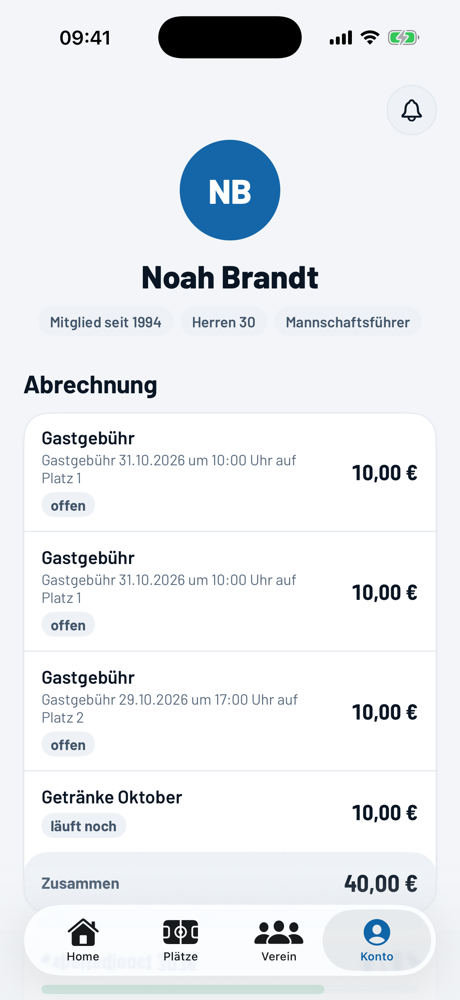 | 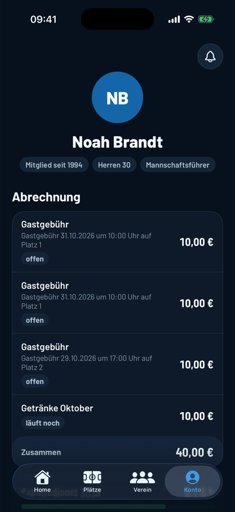 | 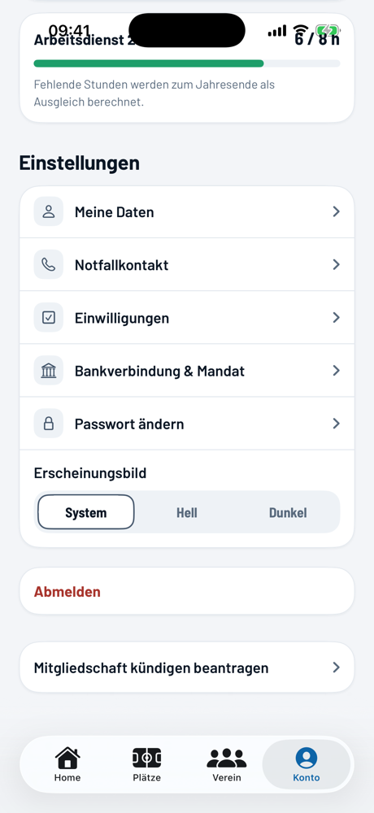 | 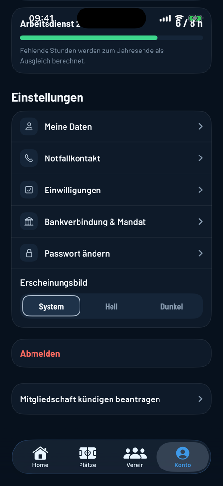 |
| 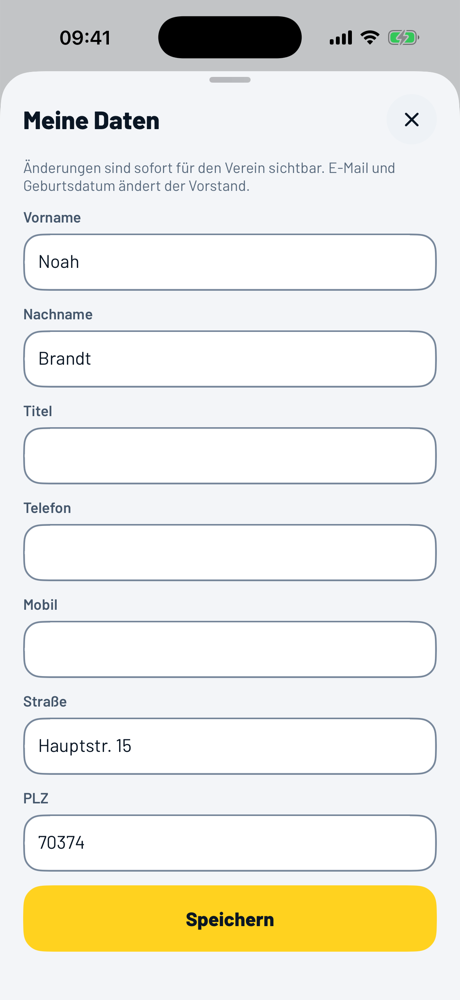 | 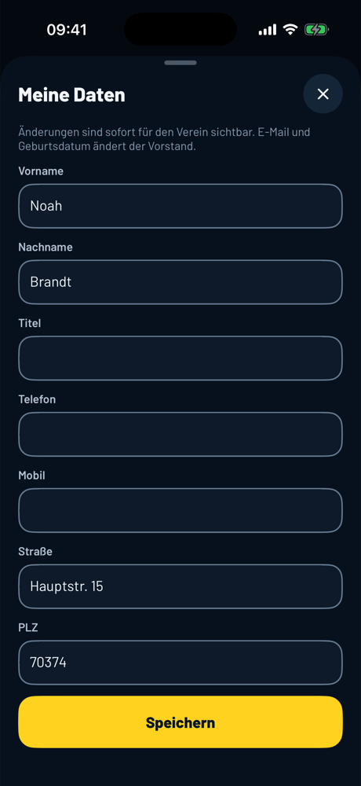 | 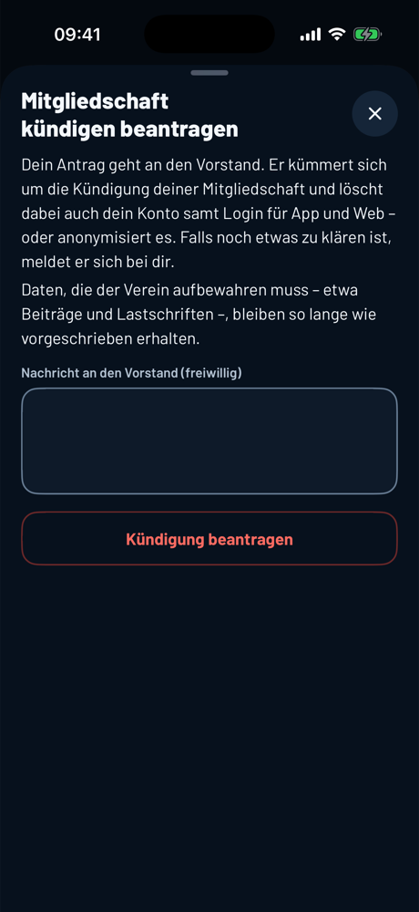 | |

Wie `apps/mobile/app/(tabs)/konto.tsx` mit seinen Blättern, Texte wortgleich (`Bildschirme/Konto/`).
Gelesen und geschrieben wird nur über RPCs (`Daten/Kontodaten.swift`): `mein_profil`, `my_charges`,
`my_drink_purchases`, `my_work_duty`, `mein_mandat`, `ich` + `member_attributes`, `save_my_profile`
(nur geänderte Felder, `""` leert), `save_my_notfallkontakt`, `set_member_attribute`,
`remove_member_attribute`, `konto_loeschung_beantragen`.

- **Profilkopf, Abrechnung, Arbeitsdienst:** jede Quelle lädt für sich, Fehler mit „Erneut versuchen“,
  Pull-to-refresh, stilles Nachladen beim Zurückkehren auf den Tab.
- **Meine Daten, Notfallkontakt:** vor dem Senden geprüft wie `memberProfileSchema` (`Kern/Profil.swift`,
  Fälle aus `schemas.test.ts` in `KontoTests`); der Fehler steht am Feld. Abweichung: Für zu lange Eingaben
  zeigt zod einen englischen Text, nativ steht „Höchstens N Zeichen.“
- **Einwilligungen** (`member_attributes`, nur selbst pflegbare), **Bankverbindung & Mandat** (nur lesen,
  IBAN nur mit den letzten vier Stellen), **Mitgliedschaft kündigen beantragen** (`Kern/Kontoloeschung.swift`).
- **Passwort ändern:** neu gegenüber der Expo-App, mit denselben Regeln wie „Passwort festlegen“
  (`PasswortRegeln`, `Sitzung.passwortSpeichern`).
- **Erscheinungsbild** System/Hell/Dunkel in `UserDefaults` (`erscheinungsbild`), gesetzt in `StartAnsicht`.
- **Abmelden** mit Rückfrage über `Sitzung.abmelden()`.
- `CHARGE_KIND_LABEL` und `merkmalBeschreibung` sind gegen die Golden Files geprüft (`KontoTests`).

Bildschirmfotos ohne Klicks (nur Debug): `-TCMTab konto` öffnet den Tab, `-TCMKontoBlatt daten|notfall|einwilligungen|bank|passwort|loeschen`
ein Blatt, `-TCMKontoRollen einstellungen` rollt zu den Einstellungen.

```bash
xcrun simctl launch booted de.tcmuckensturm.app.lokal -TCMTab konto -TCMKontoBlatt daten
```

## Plätze

| Freie Zeiten | Raster | Buchen | Eigene Buchung |
|---|---|---|---|
| 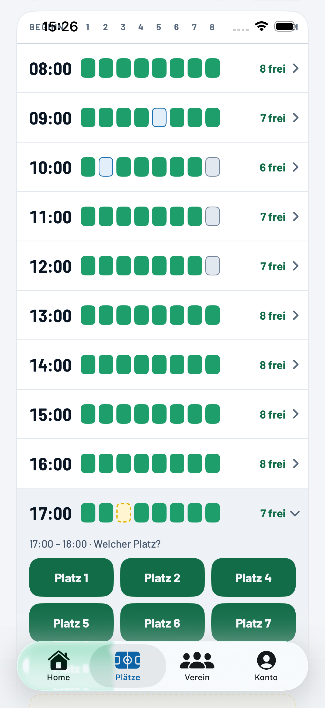 | 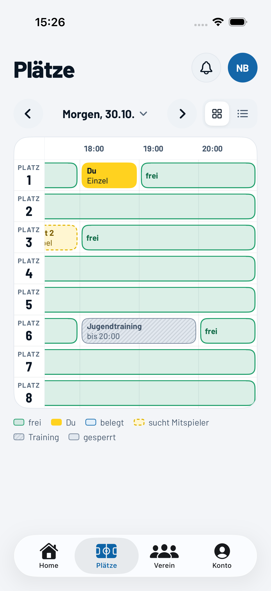 | 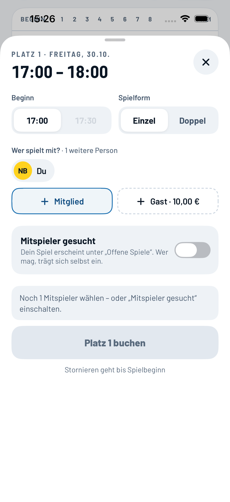 | 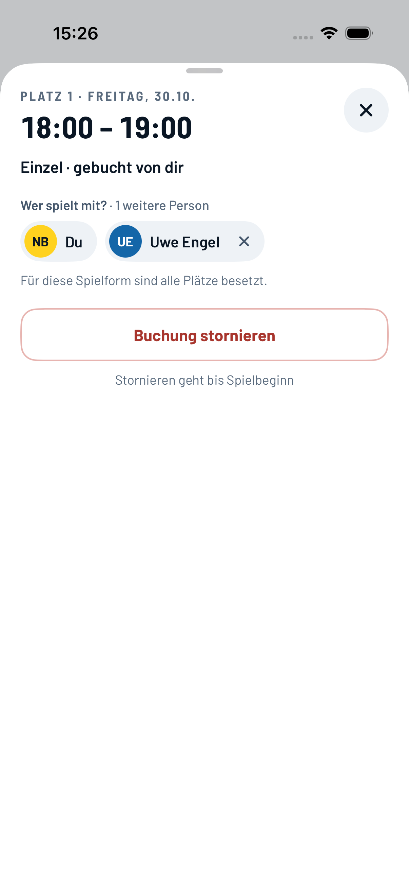 |
| 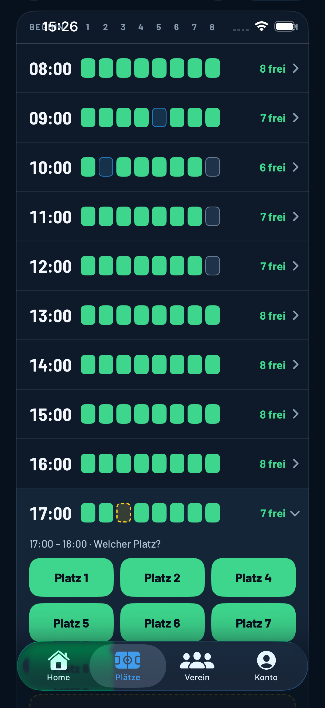 | 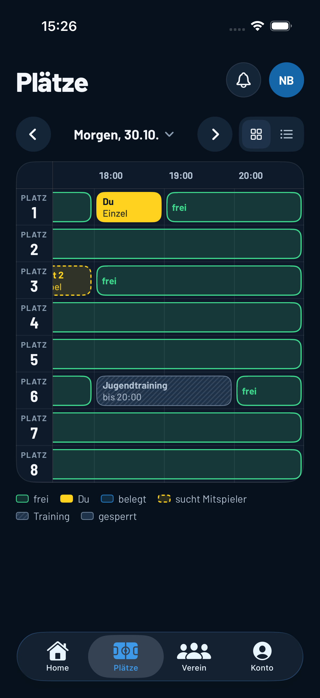 | 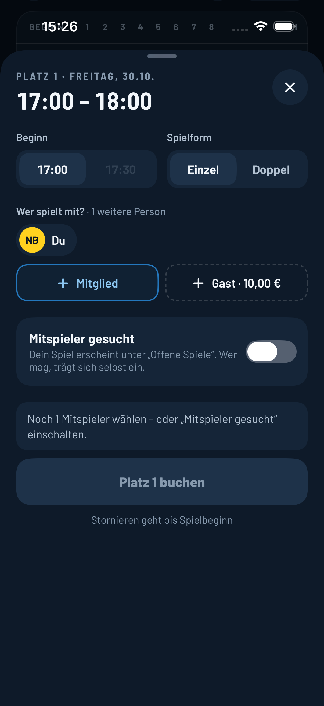 | 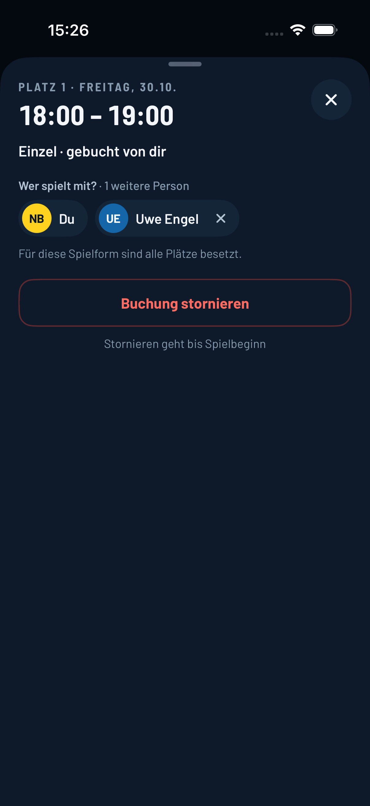 |

Wie `apps/mobile/app/(tabs)/plaetze/`, Texte wortgleich (`Bildschirme/Plaetze/`).

- **Belegungsplan:** Tag wählen bis `lead_days`, zwei Ansichten (Raster Plätze × Zeit, Freie Zeiten
  als Tabelle; gemerkt unter `tcm-plaetze-ansicht`), Pull-to-refresh, stilles Neuladen beim
  Zurückkehren in den Vordergrund. Realtime über den Kanal `plan-<datum>`, höchstens einmal pro
  Sekunde neu geladen.
- **Buchen** (`Buchungsblatt.swift`): Art, Mitspieler aus `member_directory`, Gäste, „Mitspieler
  gesucht“, Kontingent (`my_booking_quota`), Fehler über `translateDbError`.
- **Eigene Buchung:** Mitspieler ändern, stornieren mit Grund (zweistufig), Serientermin absagen,
  Mitspielersuche umschalten; offene Spiele anderer: mitspielen.
- **Sperren und Umsetzen** (mit Platzrechten): zweistufig, wenn Buchungen im Weg liegen
  (`create_blocking`/`update_blocking`, `move_booking`).
- **Logik:** neue Kernfunktionen in `Kern/Platzplan.swift` (aus `@tcm/core`, gegen die Golden Files
  `freeGaps`, `startInGap`, `occupancyLabel`, `blockingLabel`, `checkPlayers`, `missingPlayers`,
  `otherPlayersLabel`, `umsetzZiele` geprüft: `PlatzplanGoldenTests`), Ansichtslogik als reine
  Funktionen in `PlaetzeLogik.swift` (`PlaetzeLogikTests`). RPCs in `Daten/Platzdaten.swift`.

Die Bilder macht der UI-Test `PlaetzeUITests` (bucht nichts). Er erwartet im lokalen Stack für den
Folgetag ein offenes Doppel auf Platz 3 um 17:00 und eine eigene Buchung des Seed-Kontos um 18:00
auf Platz 1 (beides per `create_booking`, nur lokal):

```bash
xcrun simctl ui <geraet> appearance dark    # oder light
TEST_RUNNER_TCM_DARSTELLUNG=dunkel TEST_RUNNER_TCM_SCREENSHOTS=$PWD/docs \
  xcodebuild test -project TCMuckensturm.xcodeproj -scheme "TCMuckensturm Lokal anmelden" \
  -destination 'id=<geraet>' -derivedDataPath build/DerivedData \
  -only-testing:TCMuckensturmUITests/PlaetzeUITests
```

## Verein

| Getränke | Zuletzt | Veranstaltungen | Angemeldet | Anmelden |
|---|---|---|---|---|
| 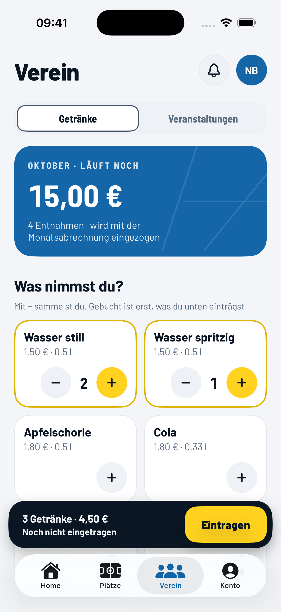 | 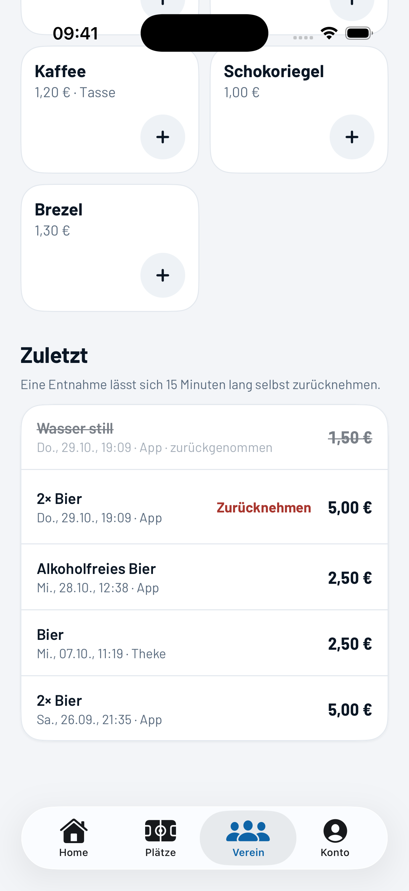 | 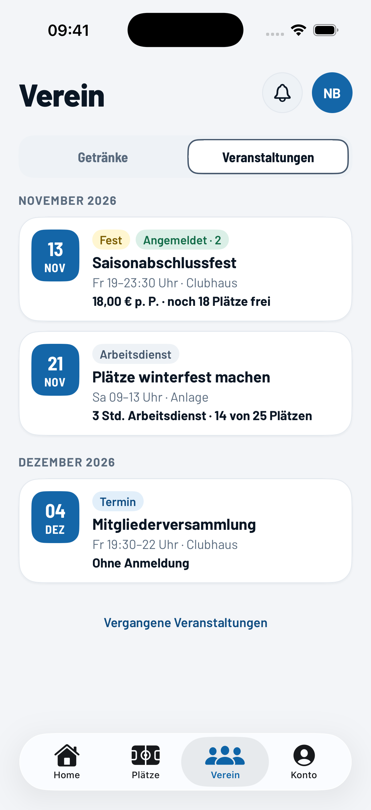 | 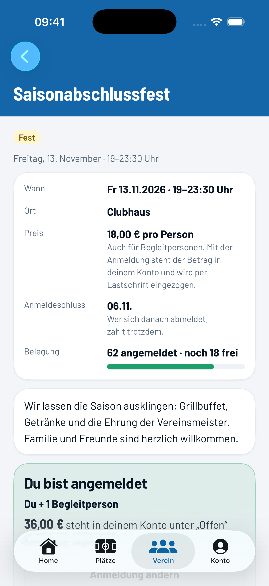 | 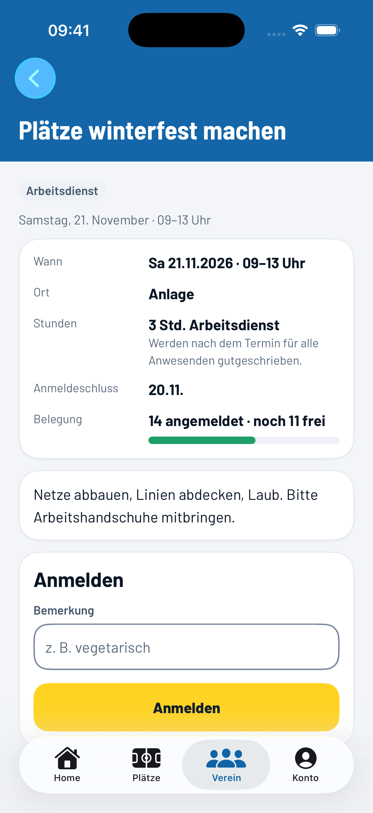 |
| 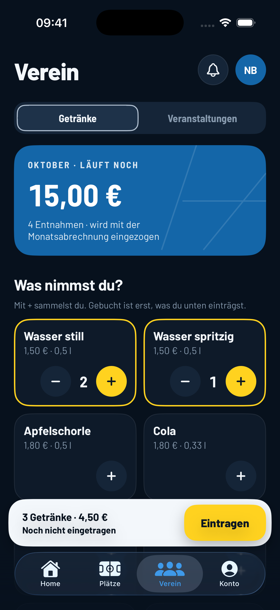 | 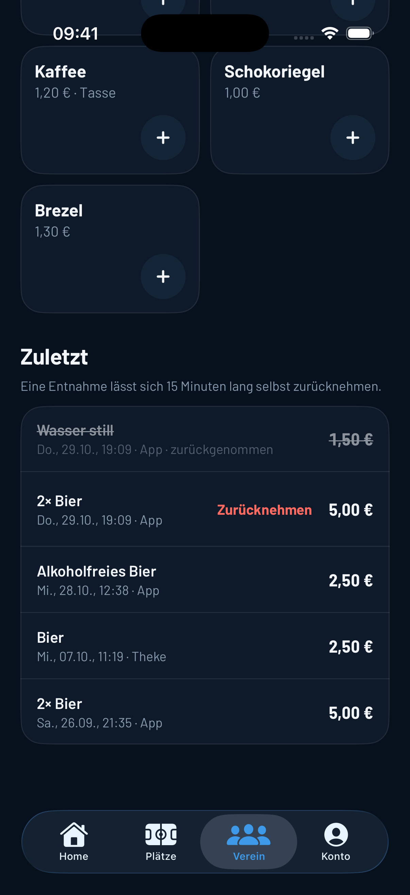 | 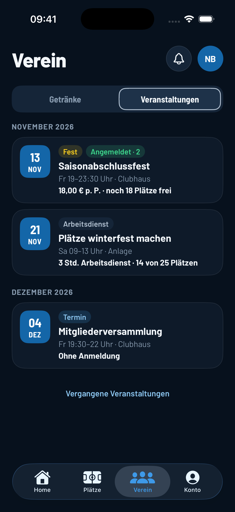 | 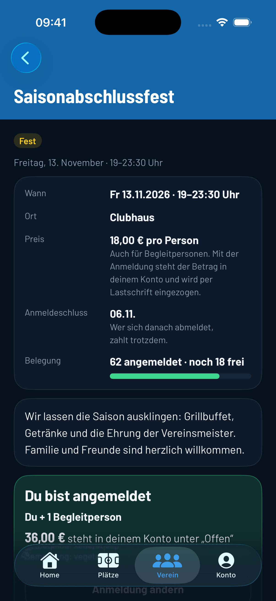 | 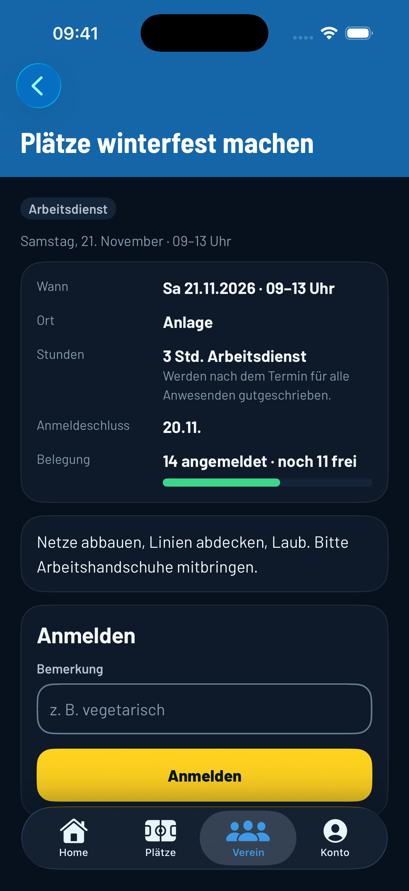 |

Wie `apps/mobile/app/(tabs)/verein/`, Texte wortgleich (`Bildschirme/Verein/`). Zwei Reiter unter
dem großen Kopf, gemerkt unter `tcm-verein-reiter` (beim ersten Mal Getränke). Nur RPCs
(`Daten/Vereinsdaten.swift`).

- **Getränke:** laufender Monat (`my_drink_purchases`), Karte als Kacheln (`drink_menu`) mit Zähler,
  gesammelt im Korb und über die Leiste unten eingetragen – je Artikel ein `record_drink_purchase`,
  nacheinander. Was scheitert, bleibt im Korb, die Meldung nennt es (`drinkBatchReport`).
  „Zuletzt“ mit Zurücknehmen (`void_drink_purchase`) nur im Stornofenster
  (`drink_void_window_minutes`, sonst 15); ein Takt alle 30 Sekunden blendet den Knopf rechtzeitig aus.
- **Korb** (U17): liegt im `VereinZustand`, den `HauptTabs` hält – er übersteht Reiter- und
  Tab-Wechsel und ist mit dem Abmelden weg. Wer die Getränke mit vollem Korb verlässt, bekommt
  „Noch nicht eingetragen“ mit „Zu den Getränken“.
- **Veranstaltungen:** nach Monat, Schalter für Vergangenes (`events_fuer_mitglied`).
- **Detail:** Eckdaten, Belegung nur als Zahl, Beschreibung; anmelden mit Begleitpersonen und
  Bemerkung (`event_anmelden`), ändern (`event_anmeldung_aendern`), abmelden mit Rückfrage
  (`event_abmelden`), Warteliste mit eigenem Platz (`event_mein_wartelistenplatz`). Der Betrag kommt
  aus `meine_forderung_cents`/`meine_forderung_status`, nicht aus `charges`.
- **Sprünge:** `zuVerein` (`Bildschirme/Navigation.swift`) öffnet einen Reiter oder gleich eine
  Veranstaltung – von Home („Getränk eintragen“, „Demnächst im Verein“, „Dein Stand“), aus den
  Neuigkeiten und der Glocke („Zur Veranstaltung ›“).
- **Logik:** `Kern/Veranstaltungen.swift` (Liste und Detail) und `Kern/Getraenke.swift` (Korb, Storno),
  geprüft gegen die Golden Files `eventMonatsGruppen`, `event*`, `changeBasket`, `basket*`,
  `drinkBatchReport`, `canVoidSelf` (`VereinGoldenTests`); Texte der Bildschirme in
  `VereinLogik.swift` (`VereinLogikTests`).

Bildschirmfotos ohne Klicks (nur Debug): `-TCMVerein getraenke|veranstaltungen|<event-id>` öffnet
Reiter oder Detail, `-TCMVereinKorb` legt zwei Artikel in den Korb, `-TCMVereinRollen zuletzt` rollt
dorthin. Die Bilder oben zeigen das Seed-Konto mit vier Veranstaltungen, Anmeldungen und Entnahmen,
die nur im lokalen Stack angelegt wurden (SQL bzw. `event_anmelden`, `record_drink_purchase`).

```bash
xcrun simctl launch booted de.tcmuckensturm.app.lokal -TCMTab verein -TCMVerein getraenke -TCMVereinKorb
```

## Onboarding

| Deine Daten | Mandat | Freigeschaltet | App-Einstellungen |
|---|---|---|---|
| 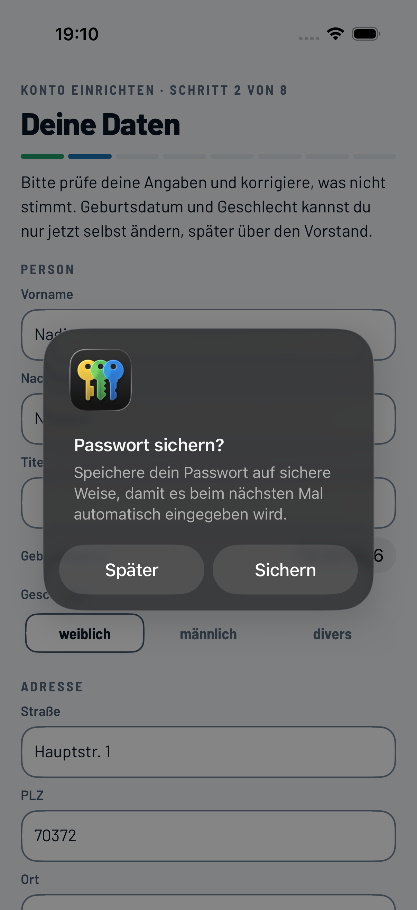 | 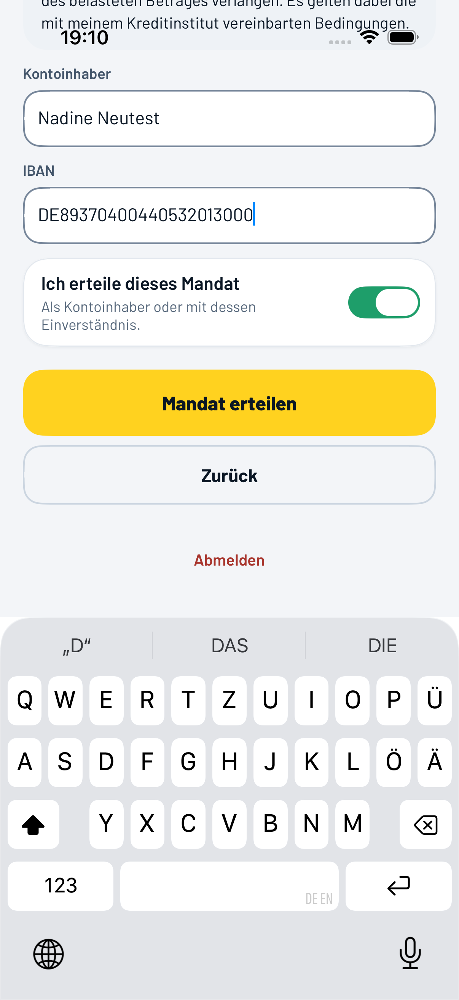 | 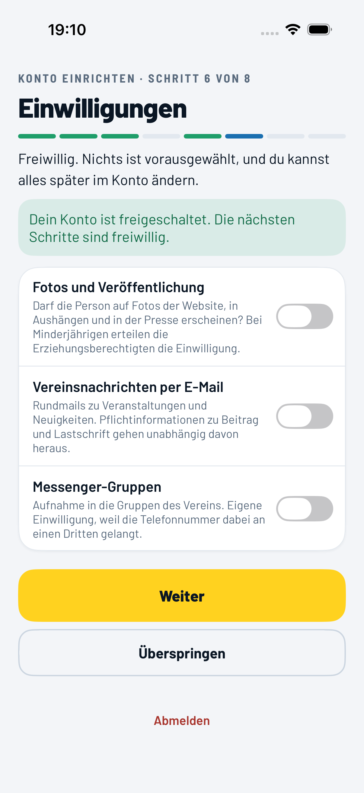 | 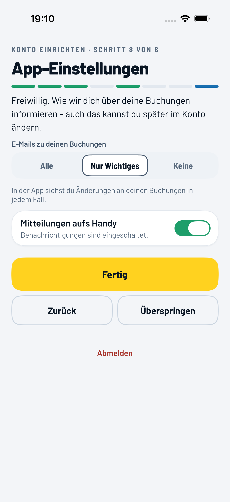 |

Wie `apps/mobile/app/onboarding.tsx`, Texte wortgleich (`Bildschirme/Onboarding/`). Die Weiche
schickt hierher, wenn `mein_zugang()` `onboarding_offen` meldet.

- **Schritte:** Reihenfolge, Titel und Pflicht aus `Kern/Onboarding.swift` (`onboardingSchritte`,
  `naechsterPflichtschritt`, `mandatstext`, IBAN-Prüfung aus `iban.ts`), erledigt laut `my_onboarding()`.
  Erziehungsberechtigte nur bei Minderjährigen, dort ist auch der Notfallkontakt Pflicht.
- **RPCs** (`Daten/Onboardingdaten.swift`): `my_onboarding`, `onboarding_save_stammdaten`,
  `onboarding_accept_documents`, `onboarding_save_guardian`, `onboarding_save_notfallkontakt`,
  `create_my_sepa_mandate`, `save_my_tennis`, `complete_onboarding`; Einwilligungen und
  `booking_mail` über `set_member_attribute`/`remove_member_attribute`, das Passwort über `update(user:)`.
  Optionale Parameter fehlen statt `null`.
- **Prüfungen vorher** wie `pruefeOnboardingStammdaten` & Co. in `daten.ts` (`OnboardingLogik`), der
  Fehler steht am Feld. Das Geburtsdatum hat einen Datumswähler (1900 bis heute), der Wert bleibt `TT.MM.JJJJ`.
- **Freischalten:** Wer das Mandat verlässt, ruft `complete_onboarding()`. Fehlt noch etwas, springt der
  Assistent zum ersten Schritt aus dem DETAIL der Meldung. Danach sind Einwilligungen, Tennis und
  App-Einstellungen freiwillig, zurück in die Pflicht geht es nicht mehr. Fertig (oder ohne Mitglied wie
  beim Kiosk): `Sitzung.onboardingVerlassen()` wechselt in die Tabs, ohne `mein_zugang` noch einmal zu fragen.
- Unten stehen Datenschutz, Impressum und Abmelden.

`-TCMOnboardingSchritt sepa` springt in Debug-Builds zu einem Schritt. Den Rundgang oben macht
`OnboardingUITests`. Er schließt ein Onboarding ab und läuft deshalb nur mit einem eigenen Konto, nie
mit `neu@`/`kind@`. Ein frisches Konto legt man lokal an, indem man den Onboarding-Block aus
`supabase/seed.sql` mit neuer E-Mail und neuen UUIDs gegen den lokalen Stack ausführt. Bleibt ein solches
Konto offen (Test abgebrochen), schlägt `test_onboarding_bestand_ist_freigeschaltet` in `pnpm db:test` fehl:
dann das Konto wieder löschen (`members` und `auth.users`, nur lokal).

```bash
TEST_RUNNER_TCM_ONBOARDING_EMAIL=n11@tcm.local TEST_RUNNER_TCM_SCREENSHOTS=$PWD/docs \
  xcodebuild test -project TCMuckensturm.xcodeproj -scheme "TCMuckensturm Lokal anmelden" \
  -destination 'id=<geraet>' -derivedDataPath build/DerivedData \
  -only-testing:TCMuckensturmUITests/OnboardingUITests
```

## Push

| Nachricht bei offener App | Getippt: Veranstaltung |
|---|---|
| 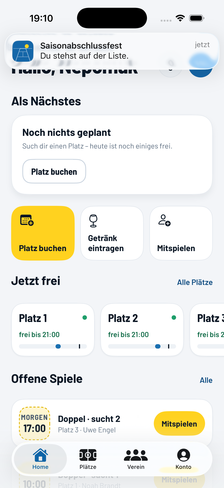 | 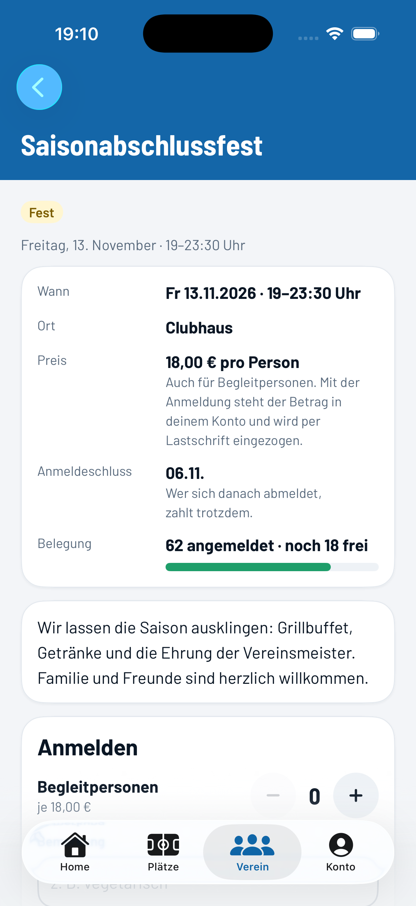 |

Wie `apps/mobile/src/lib/push.ts`, aber direkt über APNs (`App/PushAnmeldung.swift`, `Daten/Pushdaten.swift`).

- **Erlaubnis** fragt die App erst, wenn jemand „Mitteilungen aufs Handy“ einschaltet (Konto oder
  Onboarding-Schritt App-Einstellungen, `App/PushSchalter.swift`), nie vor dem Login.
- **Anmelden:** `registerForRemoteNotifications`, Marke als Hex (`Pushmarke.hex`), dann
  `register_push_token(p_token, p_platform 'ios', p_device_name, p_provider 'apns')`. Die zuletzt
  angemeldete Marke steht in `UserDefaults` (`tcm-push-marke`). Vergibt APNs später eine andere,
  meldet `auffrischen` beim Öffnen der Tabs die neue an und die alte ab.
- **Status** des Schalters über `push_token_aktiv`. Hat jemand Mitteilungen in den iOS-Einstellungen
  abgeschaltet, steht er auf aus.
- **Abmelden:** `Sitzung.abmelden()` ruft vorher `remove_push_token`, sonst bekäme das Gerät die
  Nachrichten des Vorbesitzers.
- **Tippen:** Der App-Delegate (`PushAppDelegate`) gibt `ziel`, `kind` und `event_id` an `PushZiel.aus`
  (reine Funktion, nur eigene Pfade wie `sichererWeiterPfad`). `/nachrichten` öffnet die Neuigkeiten als
  Blatt, `/verein/veranstaltung/<id>` das Detail im Verein, `/plaetze`, `/konto` usw. den Tab. Das Ziel
  wartet, bis die Tabs stehen, also auch beim Kaltstart (`App/PushNavigation.swift`).
- **Entitlement** `aps-environment` = `APS_UMGEBUNG`: `development` für Lokal und Dev, `production`
  für Prod (`Konfiguration/*.xcconfig`). Marken aus `development` gelten nur mit `APNS_UMGEBUNG=sandbox`
  an der Edge Function (`docs/native-apps.md`, Push).

Im Simulator testen (Apple-Silicon-Macs bekommen dort eine echte Marke):

```bash
# Zustellung bei offener App (Banner)
xcrun simctl push booted de.tcmuckensturm.app.lokal nachricht.json   # {"aps":{"alert":{…}},"ziel":"/nachrichten"}
# Tippen nachstellen (Debug): wie eine angetippte Nachricht mit diesem Ziel
xcrun simctl launch booted de.tcmuckensturm.app.lokal -TCMPush /verein/veranstaltung/<id>
```

## TestFlight

```sh
ASC_KEY_PATH=~/Documents/Apple/AuthKey_<id>.p8 ASC_KEY_ID=<id> ASC_ISSUER_ID=<issuer> \
  scripts/testflight.sh <buildnummer> [version]
```

Baut die Konfiguration Prod (Bundle `de.tcmuckensturm.app`, dieselbe App wie die Expo-Builds bis 16) gegen das Dev-Projekt, wie die Expo-Builds auch (`Konfiguration/TestFlight.xcconfig`), und lädt sie zu App Store Connect hoch. Die Buildnummer muss höher sein als jede bisherige.

- **Signieren:** Ein Apple-Konto des Teams muss in Xcode unter Settings → Accounts angemeldet sein. Xcode legt dann Zertifikat und Profile an und meldet App Group, Associated Domains und Push an. Der API-Schlüssel allein reicht dafür nicht (App Groups gibt es in der API nicht, das automatische Signieren lehnt ihn ab).
- **Hochladen:** mit dem API-Schlüssel von App Store Connect, über die Umgebung, nicht im Repo.
- **Lizenz:** Hat Apple die Program License Agreement erneuert, scheitert das Signieren mit „PLA Update available“, bis der Account Holder zugestimmt hat.

## Aufbau

```
TCMuckensturm/
  App/            Einstieg, Umgebung, Sitzung (Weiche, An-/Abmelden, Passwort-Links),
                  StartLogik, Passwortlink, PasswortAblauf (reine Funktionen),
                  Push (Anmeldung, App-Delegate, Ziel, Navigation, Schalter)
  Daten/          Supabase-Client, Schlüsselbund-Speicher, Anmeldefehler, Zugang (mein_zugang)
  Kern/           Rechenlogik aus @tcm/core als reine Funktionen (Zeit in Europe/Berlin, Startseite,
                  freie Plätze, Geld, translateDbError, Veranstaltungen, Getränke, Onboarding) – geprüft gegen die Golden Files
  Daten/          (siehe oben), Startdaten (Home, Glocke, Neuigkeiten), Kontodaten (Konto-Tab), Platzdaten, Vereinsdaten,
                  Onboardingdaten, Pushdaten
  Theme/          Farben und Schrift für SwiftUI auf Basis der erzeugten Tokens
  Bildschirme/    Anmeldung (mit Passwort vergessen/setzen), Kein Zugang, Home, Konto, Nachrichten (Glocke, Neuigkeiten), Onboarding, Plätze, Verein, Bausteine; die Tabs in Platzhalter.swift
  Ressourcen/     Assets (App-Icon, Logo, Markenblau), Schriften (Barlow, OFL)
TCMuckensturmTests/
```

- **Abhängigkeiten:** nur `supabase-swift`, exakt gepinnt auf 2.55.4 (in `project.yml`). Neue
  Versionen erst, wenn sie mindestens zwei Wochen alt sind.
- **Sitzung:** im Schlüsselbund mit `kSecAttrAccessibleAfterFirstUnlock` (`Daten/Schluesselbund.swift`),
  wie `apps/mobile/src/lib/supabase.ts`. Anders als expo-secure-store gibt es keine 2-KB-Grenze,
  das Teilen in Stücke entfällt.
- **Start-Logik** wie `apps/mobile/app/index.tsx`: ohne Sitzung → Anmelden; mit Sitzung →
  `mein_zugang()`: kein Zugang → „Kein Zugang mehr“ (meldet ab), Onboarding offen → Onboarding,
  sonst Tabs Home / Plätze / Verein / Konto.
- **Abmelden** nur in `Sitzung.abmelden()`.
- **Tokens:** `packages/ui/generated/Tokens.swift` (erzeugt aus `packages/ui/src/tokens.ts` mit
  `pnpm --filter @tcm/ui build:native`) ist in `project.yml` als Quelle eingebunden, nicht kopiert.
  `Farbe.ink` liest `Tokens.farben` (hell/dunkel nach Erscheinungsbild), Maße als
  `Tokens.Abstand.rand`, `Tokens.Radius.feld`, `Tokens.Schrift.seitentitel`.
- **Kern:** Zeitpunkte bleiben in den Modellen Text wie in der Expo-App; `Zeit.datum(_:)` liest
  PostgREST (`+00:00`, Mikrosekunden) wie JavaScript (`Z`). Wochentage und Monate stehen als feste
  deutsche Namen im Code, unabhängig von der Gerätesprache.
- **Home:** wie `apps/mobile/app/(tabs)/home.tsx`, jeder Abschnitt lädt für sich (Fehler mit
  „Erneut versuchen“), Pull-to-refresh, stilles Nachladen beim Zurückkehren. Was auf Bildschirme
  zeigt, die es nativ noch nicht gibt (Buchen, Spiele), wechselt vorerst auf den passenden Tab
  (`Bildschirme/Navigation.swift`, `zuTab`); Getränke und Veranstaltungen öffnet `zuVerein` gezielt.
- **Schrift:** Barlow und Barlow Semi Condensed als TTF aus `@expo-google-fonts` (Version 0.4.1),
  Lizenz SIL OFL 1.1 in `Ressourcen/Schriften/OFL.txt`.

## Was noch fehlt

- Prod-Werte (`Konfiguration/Prod.xcconfig`) und ein App-Store-Eintrag für die native App
- Verwaltung
- Verein: kompakter Titel in der Leiste beim Scrollen im Detail (`useKompakterTitel`)
- Plätze: Bereich „Meine & offene Spiele“ (`plaetze/spiele.tsx`), Sprünge aus Home direkt ins
  Buchungsblatt (`?buchen=jetzt`, `?buchung=…`), mitlaufender Tabellenkopf in Freie Zeiten
- Schwebende Tab-Leiste und kompakte Kopfzeile wie in der Expo-App (heute die System-TabView)
- Fragment-Zweig der Passwort-Links entfernen, sobald die Cloud-Vorlagen token_hash schicken (S20, gemeinsam mit Expo-App und Web)
- Widgets
- Push auf einem echten Gerät: braucht die Fähigkeit Push Notifications für die App-IDs (`.lokal`, `.dev`) im
  Apple Developer Portal und den APNs-Schlüssel als Edge-Secret (`docs/native-apps.md`, Push). Getestet ist
  bisher nur im Simulator (Marke, `register_push_token`, `simctl push`, Ziele)
- Onboarding: Bildschirmfotos dunkel
- Übernahme der Sitzung aus der Expo-App (expo-secure-store), damit Mitglieder nach dem Umstieg angemeldet bleiben
- App Groups und Associated Domains im Apple Developer Portal für `.dev`/`.lokal` registrieren (für Geräte-Builds)
- `Package.resolved` ist nicht eingecheckt (liegt im erzeugten `.xcodeproj`): die transitiven Pakete von supabase-swift werden beim ersten Bauen aufgelöst
- CI für iOS (macOS-Runner)
