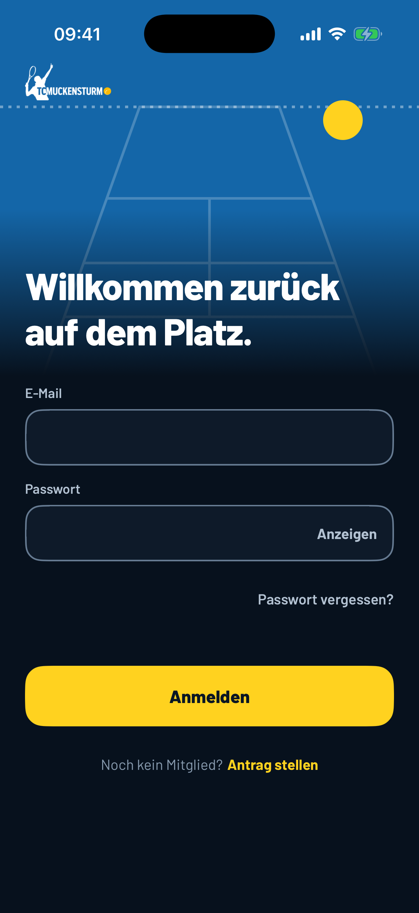
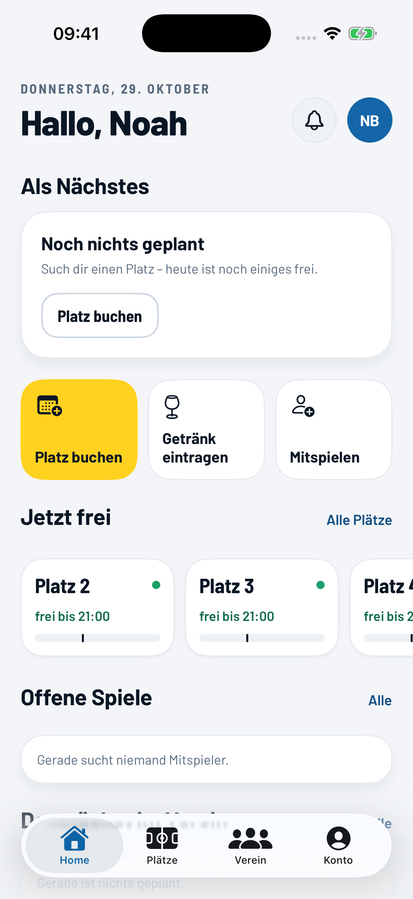
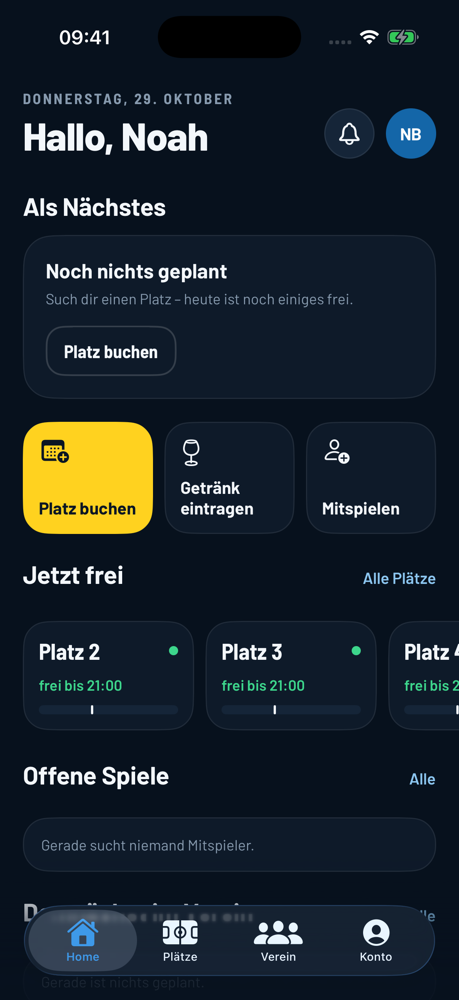
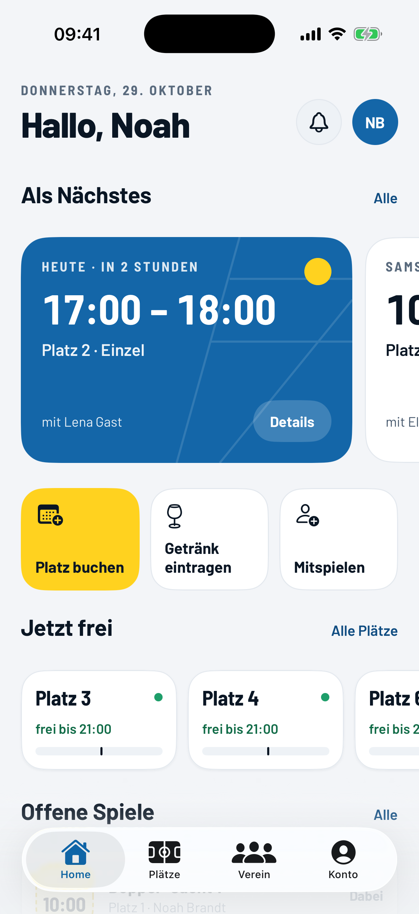
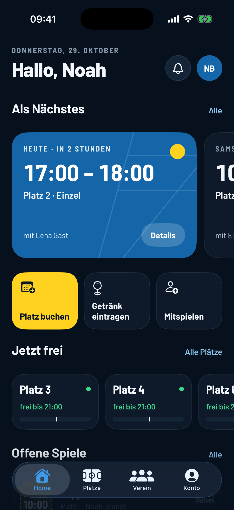
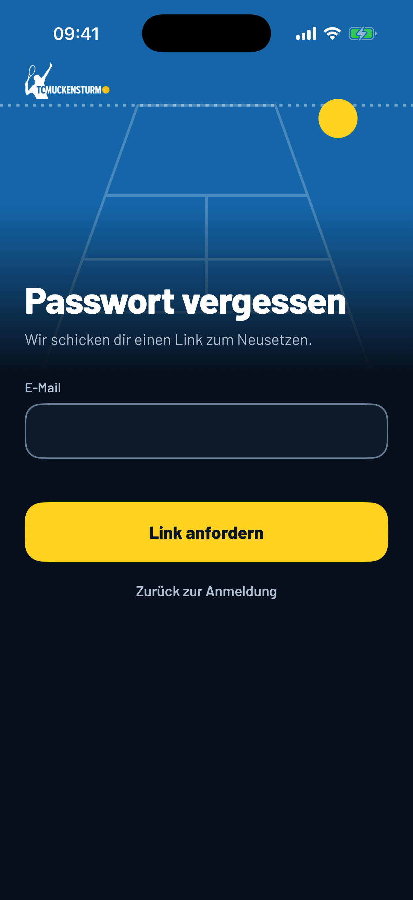
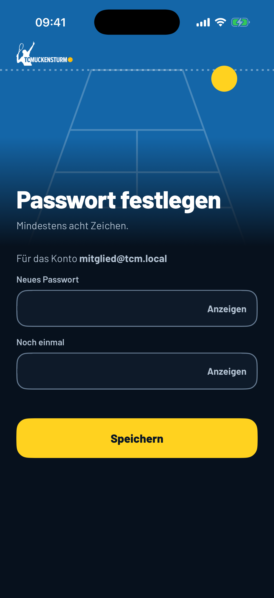
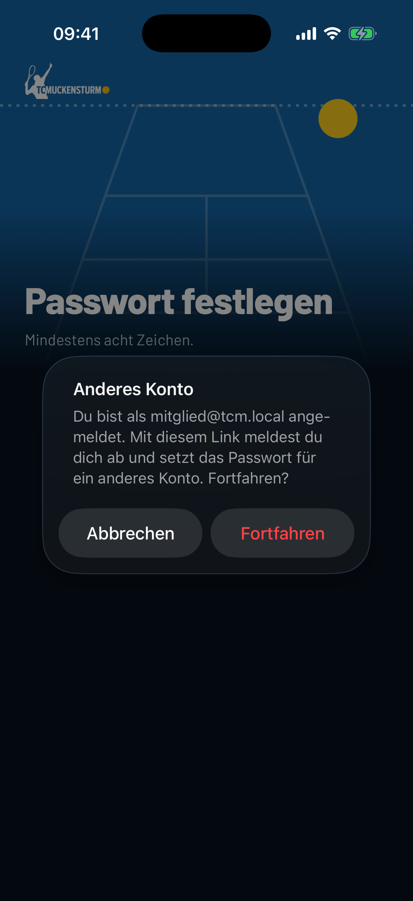

# TC Muckensturm – native iOS-App

Grundgerüst der nativen App (Swift 6, SwiftUI, iOS 17+, nur iPhone, Hochformat, Deutsch).
Die Expo-App in `apps/mobile` bleibt unverändert, bis diese App fertig ist. Web und Supabase bleiben.

| Anmeldung | Home, hell | Home, dunkel |
|---|---|---|
|  |  |  |
| |  |  |

Home zeigt das Seed-Konto `mitglied@tcm.local`, oben ohne eigene Buchungen (Leerzustand „Noch nichts
geplant“), unten mit zwei Testbuchungen, die nur im lokalen Stack per `create_booking` angelegt wurden.

## Voraussetzungen

- Xcode 26 (getestet mit 26.3, Simulator-Runtime iOS 26.3)
- [XcodeGen](https://github.com/yonaskolb/XcodeGen): `brew install xcodegen`
- Für die Konfiguration „Lokal“: der lokale Supabase-Stack (`pnpm db:start` im Repo)

Ist Xcode nicht per `xcode-select` aktiv, vor jeden Xcode-Befehl
`DEVELOPER_DIR=/Applications/Xcode.app/Contents/Developer` setzen (unten immer mit angegeben).

## Projekt erzeugen

`project.yml` ist die Quelle. Das `.xcodeproj` wird erzeugt und nicht eingecheckt:

```bash
cd apps/ios
scripts/lokal-konfigurieren.sh   # einmalig: Konfiguration/Lokal.geheim.xcconfig anlegen
xcodegen generate
open TCMuckensturm.xcodeproj     # optional
```

Nach jeder Änderung an `project.yml` oder an neuen/gelöschten Dateien erneut `xcodegen generate`.

## Bauen und testen

```bash
cd apps/ios
export DEVELOPER_DIR=/Applications/Xcode.app/Contents/Developer
xcrun simctl list devices available          # ein iPhone auswählen

# Tests (Konfiguration Lokal)
xcodebuild test -project TCMuckensturm.xcodeproj -scheme TCMuckensturm \
  -destination 'platform=iOS Simulator,name=iPhone 17' -derivedDataPath build/DerivedData

# Dev-Build für den Simulator, installieren und starten
xcodebuild build -project TCMuckensturm.xcodeproj -scheme "TCMuckensturm Dev" -configuration Dev \
  -destination 'platform=iOS Simulator,name=iPhone 17' -derivedDataPath build/DerivedData
xcrun simctl boot "iPhone 17"
xcrun simctl install booted build/DerivedData/Build/Products/Dev-iphonesimulator/TCMuckensturm.app
xcrun simctl launch booted de.tcmuckensturm.app.dev
xcrun simctl io booted screenshot docs/anmelden.png
```

Die Tests laufen in der App als Host. Sie decken ab: `Umgebung` (Info.plist-Werte, Rückleitung), den
Schlüsselbund-Speicher gegen den echten Simulator-Schlüsselbund (eigener Test-Dienst, auch mit
App Group), die Zuordnung der Anmeldefehler (dieselben Fälle wie
`packages/core/src/anmeldefehler.test.ts`), die Start-Logik als reine Funktion, die Auswertung der
Passwort-Links (dieselben Fälle wie `apps/mobile/src/lib/passwortlink.test.ts`), Passwortregeln und
den Ablauf beim Öffnen eines Links, die Token-Farben hell/dunkel und das Laden der Schriften.
Dazu der Swift-Kern gegen **jeden Fall** der Golden Files
in `packages/core/golden/` (`KernGoldenTests`, Ordner als Testressource eingebunden), weitere
Kern-Fälle aus den Vitest-Tests (`KernTests`), das Decoding der Home-Modelle mit Beispiel-JSON
(`StartdatenTests`) und die View-Logik von Home, Glocke und Neuigkeiten (`HomeLogikTests`).

### Screenshots gegen den lokalen Stack

Ohne den Simulator von Hand zu bedienen: Das Scheme `TCMuckensturm Lokal anmelden` (UI-Test
`LokalAnmeldenUITests`) meldet die Konfiguration Lokal mit dem Seed-Konto an
(`mitglied@tcm.local`, Passwort aus `supabase/seed.sql`; andere Werte über `TCM_EMAIL` /
`TCM_PASSWORT`). Die Sitzung bleibt im Schlüsselbund, danach geht der Rest mit `simctl`:

```bash
xcodebuild test -project TCMuckensturm.xcodeproj -scheme "TCMuckensturm Lokal anmelden" \
  -destination 'platform=iOS Simulator,name=iPhone 17' -derivedDataPath build/DerivedData
xcrun simctl ui booted appearance dark       # oder light
xcrun simctl launch booted de.tcmuckensturm.app.lokal
xcrun simctl io booted screenshot docs/home-leer-dunkel.png
```

`pnpm verify` im Repo-Wurzelverzeichnis berührt `apps/ios` nicht. Eine CI für iOS gibt es noch
nicht (braucht einen macOS-Runner).

## Konfigurationen

| Konfiguration | Supabase | Bundle-ID | Name auf dem Home-Bildschirm | URL-Schema | SITE_URL |
|---|---|---|---|---|---|
| `Lokal` | lokaler Stack (`127.0.0.1:54321`), Werte aus `Konfiguration/Lokal.geheim.xcconfig` (gitignored) | `de.tcmuckensturm.app.lokal` | TCM Lokal | `tcmlokal` | – |
| `Dev` | Dev-Projekt, Werte aus `apps/mobile/eas.json` (öffentlicher Publishable Key) | `de.tcmuckensturm.app.dev` | TCM Dev | `tcmdev` | `https://dev.tennisclub-muckensturm.de` |
| `Prod` | **TODO** – Werte fehlen noch, der Build zeigt den Hinweis „Konfiguration fehlt“ | `de.tcmuckensturm.app` | TC Muckensturm | `tcm` | `https://app.tennisclub-muckensturm.de` |

- Werte stehen in `Konfiguration/*.xcconfig` und kommen über die `Info.plist` (`TCMSupabaseURL`,
  `TCMSupabaseKey`, `TCMSiteURL`, `TCMAppGroup`, `TCMURLSchema`) in die App (`App/Umgebung.swift`).
- In xcconfig beginnt mit `//` ein Kommentar. Adressen deshalb als `https:/$()/beispiel.de`.
- `scripts/lokal-konfigurieren.sh` liest `apps/mobile/.env` und nimmt die Werte nur, wenn die
  Adresse lokal ist; sonst `apps/web/.env.local`. „Lokal“ läuft so nie gegen Dev oder Prod. Von
  Hand geht es mit `Konfiguration/Lokal.geheim.xcconfig.example`.
- Schemes: `TCMuckensturm` (Run/Test mit Lokal, Archive mit Dev), `TCMuckensturm Dev` (Run/Archive mit Dev).
- Team `93Z2KKGMV7`, automatisches Signieren.
- Entitlements (`TCMuckensturm/TCMuckensturm.entitlements`): App Group `group.<Bundle-ID>`
  (für Prod also `group.de.tcmuckensturm.app`), zugleich Access Group des Schlüsselbunds;
  Associated Domains `applinks:app.tennisclub-muckensturm.de` und `applinks:dev.tennisclub-muckensturm.de`.

## Passwort vergessen und setzen

| Passwort vergessen | Passwort festlegen | Anderes Konto angemeldet |
|---|---|---|
|  |  |  |

Wie `apps/mobile/app/passwort-vergessen.tsx` und `passwort-setzen.tsx`, Texte wortgleich.

- **Anfordern** (`Bildschirme/Anmeldung/PasswortVergessenBildschirm.swift`): `resetPasswordForEmail`
  mit `redirectTo` = `<SITE_URL>/passwort-setzen` (Universal Link), ohne SITE_URL (Lokal)
  `<URL-Schema>://passwort-setzen`. Die Erfolgsmeldung ist immer dieselbe, egal ob es die Adresse
  gibt. Nur Störungen (kein Netz, Server) werden gemeldet, „zu viele Versuche“ nicht – das meldet
  Auth nur für Adressen, die es gibt. Das Ziel muss in der **Redirect-Allowlist** des
  Supabase-Projekts stehen (lokal: `supabase/config.toml`, Cloud: Dashboard).
- **Link** (`App/Passwortlink.swift`, reine Funktion): angenommen werden
  `https://app.tennisclub-muckensturm.de/passwort-setzen…`, `https://dev.…/passwort-setzen…` und als
  Rückfall `tcm://`, `tcmdev://`, `tcmlokal://passwort-setzen`. Ausgewertet wie `passwortlink.ts`:
  `?token_hash=…&type=invite|recovery`, übergangsweise die Sitzung im Fragment (S20), Fehler im Link.
  Universal Links brauchen die `apple-app-site-association` im Web (Spur N3).
- **Einlösen und setzen** (`App/Sitzung.swift`, `App/PasswortAblauf.swift`,
  `Bildschirme/Anmeldung/PasswortSetzenBildschirm.swift`): `verifyOTP(tokenHash:type:)` bzw.
  `setSession` mit 15 s Frist, dann neues Passwort (mindestens acht Zeichen, zweimal gleich),
  `update(user:)`, danach in die Weiche. Solange ein Link offen ist, liegt „Passwort festlegen“
  über der Weiche.
- **Anderes Konto angemeldet** (Security-Audit, Login-CSRF): Die App meldet nicht still ab, sondern
  fragt „Du bist als … angemeldet. Mit diesem Link meldest du dich ab und setzt das Passwort für ein
  anderes Konto. Fortfahren?“. Abbrechen verwirft den Link, Fortfahren meldet über
  `Sitzung.abmelden()` ab. Ein `token_hash` verrät das Konto nicht, deshalb fragt die App bei jeder
  bestehenden Anmeldung; ein Fragment-Link fürs eigene Konto geht ohne Rückfrage durch.
- Der Client nutzt `flowType: .implicit` wie supabase-js in der Expo-App. Mit PKCE (Vorgabe von
  supabase-swift) hinge der Link an einem Schlüssel auf dem anfordernden Gerät.

Bildschirmfotos ohne Klicks (nur Debug, also `Lokal`): `-TCMPasswortVergessen` öffnet „Passwort
vergessen“, `-TCMLink <url>` öffnet einen Link wie `onOpenURL`. `xcrun simctl openurl` geht auch,
iOS fragt beim eigenen Schema aber erst „In ‚TCM Lokal‘ öffnen?“.

```bash
xcrun simctl launch booted de.tcmuckensturm.app.lokal -TCMPasswortVergessen
# token_hash aus Mailpit (http://127.0.0.1:54324) nach "Passwort vergessen"
xcrun simctl launch booted de.tcmuckensturm.app.lokal -TCMLink "tcmlokal://passwort-setzen?token_hash=<hash>&type=recovery"
```

## Aufbau

```
TCMuckensturm/
  App/            Einstieg, Umgebung, Sitzung (Weiche, An-/Abmelden, Passwort-Links),
                  StartLogik, Passwortlink, PasswortAblauf (reine Funktionen)
  Daten/          Supabase-Client, Schlüsselbund-Speicher, Anmeldefehler, Zugang (mein_zugang)
  Kern/           Rechenlogik aus @tcm/core als reine Funktionen (Zeit in Europe/Berlin, Startseite,
                  freie Plätze, Geld, translateDbError, Veranstaltungen) – geprüft gegen die Golden Files
  Daten/          (siehe oben) und Startdaten: RPCs und Modelle für Home, Glocke, Neuigkeiten
  Theme/          Farben und Schrift für SwiftUI auf Basis der erzeugten Tokens
  Bildschirme/    Anmeldung (mit Passwort vergessen/setzen), Kein Zugang, Home, Nachrichten (Glocke, Neuigkeiten), Bausteine, Platzhalter
  Ressourcen/     Assets (App-Icon, Logo, Markenblau), Schriften (Barlow, OFL)
TCMuckensturmTests/
```

- **Abhängigkeiten:** nur `supabase-swift`, exakt gepinnt auf 2.55.4 (in `project.yml`). Neue
  Versionen erst, wenn sie mindestens zwei Wochen alt sind.
- **Sitzung:** im Schlüsselbund mit `kSecAttrAccessibleAfterFirstUnlock` (`Daten/Schluesselbund.swift`),
  wie `apps/mobile/src/lib/supabase.ts`. Anders als expo-secure-store gibt es keine 2-KB-Grenze,
  das Teilen in Stücke entfällt.
- **Start-Logik** wie `apps/mobile/app/index.tsx`: ohne Sitzung → Anmelden; mit Sitzung →
  `mein_zugang()`: kein Zugang → „Kein Zugang mehr“ (meldet ab), Onboarding offen → Platzhalter,
  sonst Tabs Home / Plätze / Verein / Konto (Platzhalter).
- **Abmelden** nur in `Sitzung.abmelden()`.
- **Tokens:** `packages/ui/generated/Tokens.swift` (erzeugt aus `packages/ui/src/tokens.ts` mit
  `pnpm --filter @tcm/ui build:native`) ist in `project.yml` als Quelle eingebunden, nicht kopiert.
  `Farbe.ink` liest `Tokens.farben` (hell/dunkel nach Erscheinungsbild), Maße als
  `Tokens.Abstand.rand`, `Tokens.Radius.feld`, `Tokens.Schrift.seitentitel`.
- **Kern:** Zeitpunkte bleiben in den Modellen Text wie in der Expo-App; `Zeit.datum(_:)` liest
  PostgREST (`+00:00`, Mikrosekunden) wie JavaScript (`Z`). Wochentage und Monate stehen als feste
  deutsche Namen im Code, unabhängig von der Gerätesprache.
- **Home:** wie `apps/mobile/app/(tabs)/home.tsx`, jeder Abschnitt lädt für sich (Fehler mit
  „Erneut versuchen“), Pull-to-refresh, stilles Nachladen beim Zurückkehren. Was auf Bildschirme
  zeigt, die es nativ noch nicht gibt (Buchen, Spiele, Getränke, Veranstaltungen, Konto), wechselt
  vorerst auf den passenden Tab (`Bildschirme/Navigation.swift`, `zuTab`).
- **Schrift:** Barlow und Barlow Semi Condensed als TTF aus `@expo-google-fonts` (Version 0.4.1),
  Lizenz SIL OFL 1.1 in `Ressourcen/Schriften/OFL.txt`.

## Was noch fehlt

- Prod-Werte (`Konfiguration/Prod.xcconfig`) und ein App-Store-Eintrag für die native App
- Onboarding, Tabs Plätze/Verein/Konto, Verwaltung
- Schwebende Tab-Leiste und kompakte Kopfzeile wie in der Expo-App (heute die System-TabView)
- „Passwort ändern“ im Konto-Tab (der Ablauf `.eigenesKonto` steht schon, es fehlt der Einstieg)
- Fragment-Zweig der Passwort-Links entfernen, sobald die Cloud-Vorlagen token_hash schicken (S20, gemeinsam mit Expo-App und Web)
- Push (inkl. Push-Token-Abmeldung in `Sitzung.abmelden()`), Widgets
- Übernahme der Sitzung aus der Expo-App (expo-secure-store), damit Mitglieder nach dem Umstieg angemeldet bleiben
- App Groups und Associated Domains im Apple Developer Portal für `.dev`/`.lokal` registrieren (für Geräte-Builds)
- `Package.resolved` ist nicht eingecheckt (liegt im erzeugten `.xcodeproj`): die transitiven Pakete von supabase-swift werden beim ersten Bauen aufgelöst
- CI für iOS (macOS-Runner)
